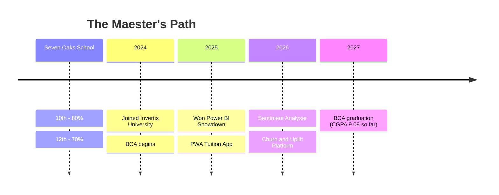

<!-- ═══════════════════ HOUSE TRIPATHI · GITHUB PROFILE ═══════════════════ -->

<div align="center">


<a href="https://github.com/tripathi-yash">
  
</a>

<br/>


</div>

---

## 🏰 &nbsp;The Maester's Scroll &nbsp;`about.md`

```text
╔══════════════════════════════════════════════════════════════╗
║  NAME      : Yash Tripathi, of House Tripathi                ║
║  REALM     : Shahjahanpur, Uttar Pradesh                     ║
║  CITADEL   : Invertis University (BCA 2024 – 2027)           ║
║  TITLE     : Aspiring Data Science Intern                    ║
║  WEAPONS   : Python · ML · Deep Learning · Flask · Power BI  ║
║  CREED     : "Ship models. Explain them. Repeat."            ║
║  BANNER    : 🐺 + 🐉  (Direwolf of the North, Dragon of Data) ║
╚══════════════════════════════════════════════════════════════╝
```

I build machine learning systems, teach them to reason about customers and language, and deploy them so that anyone in the Seven Kingdoms can use them.

---

## ⚔️ &nbsp;Choose Your House &nbsp;*(click to expand)*

<details>
<summary><b>🐺 &nbsp;House Stark — The Pythonic North</b> &nbsp;<i>"Winter is coming"</i></summary>
<br/>

Honour, discipline and a language that never betrays you.


</details>

<details>
<summary><b>🐉 &nbsp;House Targaryen — Fire & Deep Learning</b> &nbsp;<i>"Fire and Blood"</i></summary>
<br/>

Where neural networks breathe fire.


</details>

<details>
<summary><b>🦁 &nbsp;House Lannister — The Gold of Machine Learning</b> &nbsp;<i>"A Lannister always pays his debts"</i></summary>
<br/>

Precision, wealth of features and a model that always pays off.


</details>

<details>
<summary><b>🦌 &nbsp;House Baratheon — Forged in Flask & Deployment</b> &nbsp;<i>"Ours is the Fury"</i></summary>
<br/>

Models mean nothing until they reach the people.


</details>

<details>
<summary><b>🌹 &nbsp;House Tyrell — Growing Visual Gardens</b> &nbsp;<i>"Growing Strong"</i></summary>
<br/>

Turning raw data into dashboards worth a feast.


</details>

<details>
<summary><b>🐙 &nbsp;House Greyjoy — The Databases We Do Not Sow</b> &nbsp;<i>"We Do Not Sow"</i></summary>
<br/>


</details>

<details>
<summary><b>📚 &nbsp;The Citadel — CS Fundamentals</b> &nbsp;<i>"Knowledge is power"</i></summary>
<br/>


</details>

---

## 🗡️ &nbsp;Conquests of the Realm &nbsp;*(Projects)*

> ⚠️ Replace each `REPO-NAME` below with the real repository name (and add the live Hugging Face / Render links).

<table>
<tr>
<td width="33%" valign="top">

### 🐉 Telecom Churn & Uplift
*June 2026 · Individual*

Predicts customers at risk of leaving **and** finds the persuadable ones using treatment/control uplift modelling.

`Python` `Scikit-Learn` `XGBoost` `SHAP` `SQLite` `Flask` `HF Spaces`

[⚔️ **View Project**](https://github.com/tripathi-yash/REPO-NAME)

</td>
<td width="33%" valign="top">

### 🐺 Movie Sentiment Analyser
*May 2026 · Group*

A movie-review sentiment classifier trained on the IMDB dataset, with full text preprocessing, LSTM and a web app.

`TensorFlow` `LSTM` `Logistic Regression` `Flask` `Docker` `HF Spaces`

[⚔️ **View Project**](https://github.com/tripathi-yash/REPO-NAME)

</td>
<td width="33%" valign="top">

### 🏰 PWA Tuition App
*Dec 2025 · Individual*

Student management and attendance tracker with authentication, search and analytics.

`Python` `Flask` `SQLite` `JavaScript` `Vanilla CSS` `Render`

[⚔️ **View Project**](https://github.com/tripathi-yash/REPO-NAME)

</td>
</tr>
</table>

<details>
<summary><b>🔮 &nbsp;Pinned-style live repo cards</b> &nbsp;<i>(click to summon)</i></summary>
<br/>

<div align="center">

<a href="https://github.com/tripathi-yash/REPO-NAME">

</a>
<a href="https://github.com/tripathi-yash/REPO-NAME">

</a>
<a href="https://github.com/tripathi-yash/REPO-NAME">

</a>

</div>

</details>

---

## 📊 &nbsp;The Royal Treasury &nbsp;*(Live GitHub Stats)*

<div align="center">


<br/>


<br/>


</div>

### 🔥 &nbsp;Wildfire Activity — *the realm's contribution graph*

<div align="center">

</div>

### 🐍 &nbsp;The Snake of the Night's Watch

<div align="center">
<picture>
  <source media="(prefers-color-scheme: dark)" srcset="https://raw.githubusercontent.com/tripathi-yash/tripathi-yash/output/github-contribution-grid-snake-dark.svg">
  <source media="(prefers-color-scheme: light)" srcset="https://raw.githubusercontent.com/tripathi-yash/tripathi-yash/output/github-contribution-grid-snake.svg">
  
</picture>
</div>

---

## 📜 &nbsp;Maester's Chain &nbsp;*(Certifications)*

| Link of the Chain | Granted By | Proof |
|:--|:--|:--|
| 🧙 **LLM for Young Developers** | AICTE · NASSCOM · META | [View Certificate](#) |
| 🪙 **AI Skills Passport** | EY · Microsoft | [View Certificate](#) |
| 🧭 **Google AI-ML Virtual Internship** | AICTE-Edu Skills | [View Certificate](#) |
| 🔗 **IBM Artificial Intelligence Fundamentals** | IBM | [View Certificate](#) |

---

## 👑 &nbsp;Claiming the Iron Throne &nbsp;*(Awards & Publications)*

- 🥇 **Ranked 1st** at the *Dashboard Power BI Showdown*, Invertis University (Sep 2025) · [View Certificate](#)
- 📖 **Published:** *Predictive Analytics on Global Healthy Diet Cost and Prevalence of Malnutrition* · [View](#)
- 📖 **Published:** *Impact of Technology Usage on Mental Health: A Data-Driven Analysis* · [View](#)

---

## 🎓 &nbsp;Education of the Realm



---

## 🧠 &nbsp;Consult the Three-Eyed Raven

<details>
<summary><b>🔮 &nbsp;What am I working on?</b></summary>
<br/>

- 🔭 Deepening **uplift modelling** and **model explainability (SHAP)**
- 🌱 Exploring **Transformers** and **LLM applications**
- 🛠️ Taking models from notebook to **production-grade deployment**
- 🧩 Sharpening **DSA** for the interview gauntlet

</details>

<details>
<summary><b>🤝 &nbsp;Ask me about</b></summary>
<br/>

Churn prediction · Uplift modelling · Imbalanced data (SMOTE) · LSTM text classification · Flask deployment · Power BI dashboards

</details>

<details>
<summary><b>⚡ &nbsp;Fun fact</b></summary>
<br/>

I name my model versions after houses. `v1` is always Stark: honest, but it dies in the end. 🐺

</details>

---

## 🕊️ &nbsp;Send a Raven &nbsp;*(Contact)*

<div align="center">

<a href="https://www.linkedin.com/in/yash-tripathi9798"></a>
<a href="https://github.com/tripathi-yash"></a>
<a href="https://leetcode.com/tripathi-yash"></a>
<a href="mailto:YOUR-EMAIL@example.com"></a>

<br/><br/>


</div>


